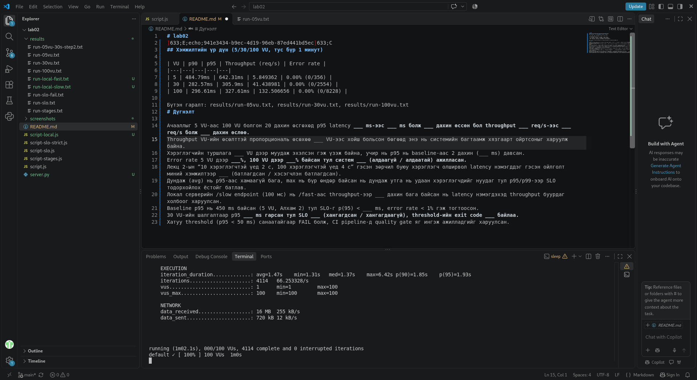

# lab02
Нэр:Д.Нурсолтан
Оюутны код: В232270039

## k6 хувилбар
```
k6 v2.4.0 (commit/dd9395906d, go1.26.11, linux/amd64)
```
## Хэмжилтийн үр дүн (5/30/100 VU, тус бүр 1 минут)

| VU | p90 | p95 | Throughput (req/s) | Error rate |
|---|---|---|---|---|
| 5 | 484.79ms | 642.31ms | 5.849362 | 0.00% (0/356) |
| 30 | 282.57ms | 305.9ms | 41.438981 | 0.00% (0/2554) |
| 100 | 296.61ms | 327.61ms | 132.506656 | 0.00% (0/8228) |

Бүтэн гаралт: results/run-05vu.txt, results/run-30vu.txt, results/run-100vu.txt

## k6 summary-ийн дэлгэцийн зураг




# Дүгнэлт


## Дүгнэлт

1. Ачааллыг 5 VU-аас 100 VU болгон 20 дахин өсгөхөд throughput 5.85 req/s-ээс 132.51 req/s болж 22.7 дахин өссөн бол p95 latency 642.31 ms-ээс 327.61 ms болж буурсан (30 VU дээр 305.90 ms).
2. Throughput VU-ийн өсөлттэй бараг пропорциональ өссөн: 5-аас 30 VU болоход 7.1 дахин (VU 6 дахин), 30-аас 100 VU болоход 3.2 дахин (VU 3.3 дахин) өссөн, VU бүрт ногдох throughput 1.17, 1.38, 1.33 req/s байсан тул 100 VU хүртэл системийн багтаамжийн хязгаарт хүрсэн шинж ажиглагдсангүй.
3. Хэрэглэгчийн туршлага муудах цэгийг p95 нь baseline (450.45 ms)-ийн 2 дахин буюу 900 ms-ээс давсан түвшнээр тодорхойлсон бөгөөд 5, 30, 100 VU дээрх p95 (642.31, 305.90, 327.61 ms) аль нь ч үүнийг даваагүй тул 100 VU хүртэл ийм цэг ажиглагдаагүй.
4. Error rate 5, 30, 100 VU бүх түвшинд 0.00% байсан тул систем алдаагүй ажилласан.
5. Лекц 2-ын "хэрэглэгч олширвол latency нэмэгддэг" гэсэн зөрчил миний хэмжилтээр батлагдаагүй: p95 30-аас 100 VU болоход ердөө 7.1% (305.90 ms-ээс 327.61 ms) өссөн, 5 VU дээр бүр өндөр (642.31 ms) байсан нь бага ачааллын үед цөөн тооны удаан хүсэлт (max 3.68 s) хэмжилтэд илүү их нөлөөлснөөс байж болзошгүй.
6. 100 VU дээр avg 218.09 ms, p95 327.61 ms, max 3.62 s байсан буюу хамгийн удаан хүсэлт дунджаас 16.6 дахин удаан байсан нь дундаж утга удаан хэрэглэгчдийг нууж, SLO-г p95/p99-ээр тодорхойлох ёстойг батлав.
7. 5 VU-ийн ижил тохиргоог 30 секундээр (p95 = 450.45 ms, results/run-05vu-30s-step2.txt) болон 1 минутаар (p95 = 642.31 ms) ажиллуулахад p95 42.6%-иар зөрсөн нь load тестийн үр дүн сүлжээ, цаг хугацаанаас хамаарч өөр гардгийг харуулж байгаа тул бүтэн гаралтын файлыг хавсаргах шаардлагатай.
8. SLO-г Алхам 2-т хэмжсэн baseline p95 = 450.45 ms-ийг 1.5-аар үржүүлж p(95) < 680 ms, error rate < 1% гэж тогтоосон бөгөөд 30 VU, 1 минутын шалгалтаар p95 = 320.48 ms, error rate 0.00% гарсан тул SLO хангагдсан (threshold ✓, k6 exit code 0).
9. Санаатайгаар хатуу болгосон p(95) < 50 ms threshold нь p95 = 441.01 ms байсан тул FAIL болж (k6 exit code 99), CI pipeline-д quality gate яг ингэж build-ийг унагадаг зарчмыг харуулсан.
